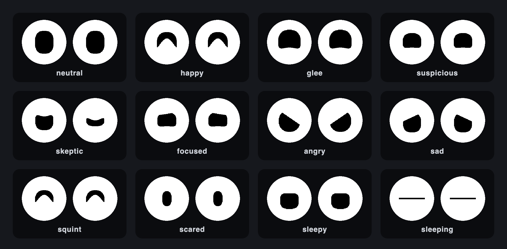
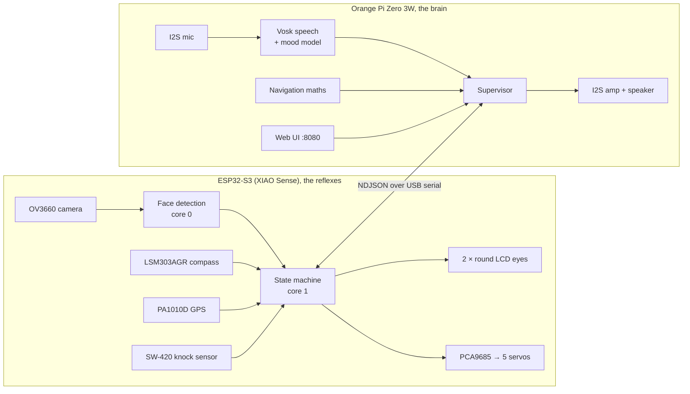

# Hubert, an open-source robot owl for your shoulder

**Hubert** is a small robot owl that rides on your shoulder. It looks at you
with two round LCD eyes and follows your face with its head. It flicks its ears,
flaps its wings and reacts when you talk to it. It also knows where north is
and can point you home. Everything runs **offline, on the owl itself**: no
cloud, no API keys, no app.

The code is in this repository (`owlmate`). The 3D-printed body is on
**[Tinkercad](https://www.tinkercad.com/things/ksBVgCSVOY0-huubert-robot-companion-owl)**.



<sub>Every eye above comes from **one** parametric drawing routine, rendered
here from the same numbers the firmware uses (`esp32-s3-sense/tools/preview_eyes.py`).
Two colours only, on purpose: details turn to mush on a 160 px panel behind a
small opening.</sub>

---

## What Hubert does

- 👀 **Expressive eyes.** Two 0.71″ round LCDs show 23 expressions, all made by
  one superellipse routine with a handful of modifiers. Hubert blinks, squints,
  glares and falls asleep.
- 🧠 **Sees you, on the chip.** Face detection runs on the ESP32-S3 itself
  (esp-dl v3, 48–91 ms per frame on its second core). The eyes and the head
  follow you with a saccade-like jump, the way a real bird does.
- 🦉 **Moves like an owl.** Five micro servos drive the head, both ears and both
  wings: idle twitches, glances, wing beats and full-body gestures (startled,
  happy, negative, curious). Every servo stays inside travel limits that were
  measured by hand at the mechanism.
- 🗣️ **Listens to its name.** Say *"Hubert, …"* and an offline speech
  recogniser (Vosk) turns the sentence into text in about 0.2 s. A tiny
  fine-tuned MiniLM classifier (int8 ONNX, ~10 ms, no LLM) maps it to a mood:
  eyes, body pose and a sound. Speech is German today.
- 🧭 **Compass and "guide me home".** A GPS and a tilt-compensated compass
  (LSM303AGR) let Hubert turn its head toward a place you taught it on a map,
  re-aiming as you walk.
- 🫨 **Feels a knock.** A vibration sensor wakes Hubert up or startles it.
- 📶 **Brings its own Wi-Fi.** Away from home, Hubert opens a hotspot named
  "Hubert" so you can still reach its web control page from your phone.
- 🛠️ **Firmware updates over the air,** a status OLED, a mute switch and a
  power button for a clean shutdown.

## Status

Hubert is a working prototype that gets worn and tested in daily life. It is
not a kit. Rough edges are listed honestly here, and in detail in
[`BACKLOG.md`](BACKLOG.md).

| Subsystem | State |
|---|---|
| Eyes (2 × LCD, shared SPI bus) | ✅ Done: 23 expressions, blink, gaze |
| Face detection + head tracking | ✅ Done: about 100 % hit rate at a normal seating distance |
| Servos: head, ears, wings | ✅ Calibrated and moving; gestures still being fine-tuned |
| Speech + mood reactions | ✅ Accepted live on the shoulder (German); rejecting TV and room noise still needs work |
| Sound (amp + mic on the Orange Pi) | ✅ Works, including a custom kernel driver |
| Compass | ✅ Calibration survives reboots; accuracy about ±15–25° |
| GPS | ✅ Works (I2C) |
| Navigation "guide me home" | 🟡 Implemented and unit-tested; the walk-it-on-the-street test is still open |
| Fallback hotspot | 🟡 Deployed and bench-tested; not yet seen in the wild |
| OTA firmware update | 🟡 Mode switch verified; a full upload over the air not yet confirmed |
| Enclosure | ✅ Printed and assembled ([Tinkercad](https://www.tinkercad.com/things/ksBVgCSVOY0-huubert-robot-companion-owl)) |

## How it works

Two computers, one job each:



- **The ESP32-S3 owns the behaviour.** The state machine, eye rendering, face
  tracking and servo choreography all run on the microcontroller, so Hubert
  stays lively even when the Linux side is busy or still booting.
- **The Orange Pi supervises and adds the slow stuff:** speech, mood, sound,
  navigation maths, logging and the web UI. It sends *policy* (sleep, wake),
  short-lived overrides and head aim angles. It is deliberately **not** a
  second state machine; an earlier version had two, and they fought over the
  eyes.
- **The two talk newline-delimited JSON** over USB serial. Every telemetry
  field is parsed on the other side, and that is enforced by tests.

The full architecture is in [Developer reference](#developer-reference) below.
Every design decision is in [`specs/`](specs/000-index.spec).

---

## Bill of materials

Prices are **rough estimates** in EUR from European retail listings in
November 2026, single quantity, including VAT, before shipping. They vary a lot
by shop and region. Treat the total as a ballpark, not a quote.

### Electronics

| # | Part | Qty | Role | ≈ € |
|---|---|:-:|---|--:|
| 1 | **Seeed Studio XIAO ESP32-S3 Sense** (with OV3660 camera) | 1 | The owl's "head computer": eyes, camera, sensors, servos | 18 |
| 2 | **Orange Pi Zero 3W** (Allwinner A733, 4 GB) | 1 | The "brain": speech, sound, navigation, web UI | 60 |
| 3 | **Waveshare 0.71″ round LCD**, 160 × 160, GC9D01, SPI | 2 | Eyes | 25 |
| 4 | **Adafruit LSM303AGR** accelerometer + magnetometer (#4413) | 1 | Tilt + compass. ⚠️ Must be the *black* LSM303**AGR** board, not the blue LSM303**DLHC** | 15 |
| 5 | **Adafruit Mini GPS PA1010D** (#4415) | 1 | Position, over I2C | 30 |
| 6 | **PCA9685** 16-channel PWM breakout | 1 | Servo driver | 10 |
| 7 | **SW-420** vibration sensor module | 1 | Knock / wake-up | 2 |
| 8 | **Adafruit MAX98357A** I2S class-D amp | 1 | Speaker driver | 7 |
| 9 | **Adafruit ICS-43434** I2S MEMS microphone (#6049) | 1 | Hearing | 8 |
| 10 | Small speaker, 4 Ω or 8 Ω | 1 | Voice | 3 |
| 11 | 0.91″ OLED, 128 × 32, SSD1306, I2C | 1 | Status display on the Orange Pi | 4 |
| 12 | Slide switch + momentary push button | 1 + 1 | Mute + clean shutdown | 2 |
| 13 | microSD card, 16 GB or more | 1 | Orange Pi OS (DietPi) | 8 |
| 14 | USB power bank (5 V) | 1 | Power | 20 |

### Mechanics

| # | Part | Qty | Role | ≈ € |
|---|---|:-:|---|--:|
| 15 | **SOL-EXPERT S18JST** 1.8 g micro servo | 4 | Ears + wings | 48 |
| 16 | **Longruner KY66** 9 g micro servo | 1 | Head turn | 4 |
| 17 | 3D-printed body ([Tinkercad](https://www.tinkercad.com/things/ksBVgCSVOY0-huubert-robot-companion-owl)), filament | — | Enclosure | 5 |
| 18 | Thin silicone wire, short Micro-USB lead, heat-shrink, hot glue | — | Harness | 10 |
| | | | **Total, roughly** | **≈ 280** |

The whole harness, pin by pin and including cable colours, is in
**[`WIRING.md`](WIRING.md)**. A few of these choices are load-bearing:

- **The camera sits upside down** in the head; the firmware flips it in
  software. If you change the mounting, change `CAM_VFLIP` too.
- **Wings and ears in this build** were labelled inconsistently during
  sourcing (1.8 g S18JST vs. 3.7 g nano servos). Measure your own servos'
  travel; never copy pulse widths from a datasheet or from this repo.
- **Another Linux board instead of the Orange Pi?** The brain is plain Python +
  ALSA. Only the sound card driver (`orangepi-brain/audio/`) is specific to the A733.
- **XIAO Sense camera:** depending on the batch it ships with an OV2640 or an
  OV3660. Hubert's firmware was verified on the OV3660.

---

## Things we learned the hard way

Hubert's [`specs/`](specs/000-index.spec) contain more than 100 written-down
*falsified hypotheses*: things we were sure of, measured, and turned out to be
wrong. A few favourites:

1. **The camera passed every test while pointing at the ceiling.** Driver OK,
   27 ms per frame, brightness dropping nicely under a hand, and 0 faces found
   in 31.5 s. Health numbers can't tell you *where* a camera looks. Now there is
   a diagnostic build that sends the actual JPEG over serial.
   ([spec 009](specs/009-face-detection.spec))
2. **The face model only sees upright faces.** With the camera mounted upside
   down: 0 hits. Vertically flipped in software: 57 hits. No threshold tuning
   could ever have fixed that.
3. **One threshold, two jobs.** The detector is a two-stage cascade, and both
   stages defaulted to 0.5, so faces were thrown away before the refiner ever
   saw them. Proposal stage at 0.1, final stage kept at 0.5: hit rate went
   from **31 % to 100 %**, with **zero** false positives in 184 attempts in an
   empty room.
4. **The compass was a mirror.** Four true bearings, 70/161/251/340°, read as
   303/214/121/31°. Every pair sums to about 372°: that's a reflection, not an
   offset. Lesson: never derive the third axis from "right-handedness".
   Measure all three, and check two bearings about 90° apart.
   ([spec 006](specs/006-imu-orientation.spec))
5. **"Both displays are dead."** A previous session lost a day to that. The
   panels have no MISO line, so *any* read-back returns `0x00`. The real bug
   was that nobody ever pulled chip-select low. ([spec 003](specs/003-display-bus.spec))
6. **4.4 → 40+ Hz by changing one condition.** The renderer marked the frame
   dirty on every loop iteration, even when nothing had changed. Raising the SPI clock
   from 16 to 40 MHz had changed exactly nothing.
7. **The knock sensor is a pulse source, not a switch.** One tap = a burst of
   ~1 kHz edges (3252 edges in 28 s of tapping). Read as a debounced level, it
   reported "tapped!" forever on a motionless owl. ([spec 007](specs/007-vibration-and-ota.spec))
8. **The average frame rate went *down* when the eyes got smoother.** Moving
   inference to the second core lowered the mean loop rate a little but removed
   every stall below 15 Hz. A mean cannot show a stall.
9. **A one-bit delay needed a kernel driver.** The A733's I2S controller puts
   audio data one bit off, and no device-tree overlay can fix that. So Hubert
   ships its own small ALSA machine driver. ([spec 015](specs/015-orangepi-audio.spec))
10. **Don't calibrate a compass next to its own servo magnets,** and don't trust
    the phone in your hand as the reference. The earth field here dips 66°
    downward, so a level turn can't calibrate the vertical axis at all.

---

## Build your own

> Hubert is a one-off build documented in detail, not a polished kit. Expect to
> adapt the mechanics to your print and to measure your own servo limits.

1. **Print the body** from
   [Tinkercad](https://www.tinkercad.com/things/ksBVgCSVOY0-huubert-robot-companion-owl).
2. **Wire it up** following [`WIRING.md`](WIRING.md). `config.h` is
   authoritative for every pin.
3. **Flash the ESP32** with PlatformIO. See [Build & flash](#build--flash). With
   servos fitted, start with the **locked** build (`-e xiao_esp32s3_locked`)
   and calibrate each servo with the `servocal` tool before you let anything
   move (see [`specs/016-servo-safety.spec`](specs/016-servo-safety.spec)).
4. **Set up the Orange Pi** with one script: `sudo ./setup.sh` in
   `orangepi-brain/` on a fresh DietPi.
5. **Calibrate the compass** by tumbling the owl slowly in free air:
   `esp32-s3-sense/tools/kalibrieren.py`.

The host-side helper scripts speak German. They were written to be read at the
bench, holding a soldering iron.

## Repository map

| Where | What |
|---|---|
| [`esp32-s3-sense/`](esp32-s3-sense) | PlatformIO firmware (Arduino + ESP-IDF): eyes, vision, sensors, servo choreography, plus 11 single-purpose diagnostic builds |
| [`orangepi-brain/`](orangepi-brain) | Python supervisor: speech, mood, sound, navigation, web UI, systemd units, kernel audio driver |
| [`specs/`](specs/000-index.spec) | **Why** everything is the way it is: decisions, measurements, falsified beliefs |
| [`WIRING.md`](WIRING.md) | The harness as physically built |
| [`BACKLOG.md`](BACKLOG.md) | What's next, in dependency order |
| [`AGENTS.md`](AGENTS.md) | Guide for AI coding agents (and a dense technical overview for humans) |

## Contributing

Issues, questions, remixes and pull requests are welcome. Photos of your own
owl are even better. Before you re-diagnose anything, read that subsystem's
**Falsified** section in `specs/`; it may save you a day. `python3
tools/check_docs.py` keeps the docs honest, and `python3
orangepi-brain/tests/run_tests.py` runs the brain's test suite on any laptop
(no Orange Pi needed).

Comments in the firmware are partly German. That is intentional, see
[`AGENTS.md`](AGENTS.md#a-note-on-language--the-mixed-languages-are-intended).

## License

- **Code** (firmware, brain, tools): [MIT](LICENSE)
- **3D model, documentation and images:**
  [CC BY-SA 4.0](LICENSE-CC-BY-SA-4.0.txt). Remix it, credit it, share it alike.

Third-party components (esp-dl, Adafruit libraries, Vosk models, …) keep their
own licenses.

---
---

# Developer reference

Everything below is the technical reference: hardware tables, protocol, build,
first run. The *why* behind each choice lives in [`specs/`](specs/000-index.spec).

## Hardware

### Main board
- **Seeed Studio XIAO ESP32-S3 Sense**: ESP32-S3 dual-core @ 240 MHz, 8 MB
  flash, 8 MB PSRAM (octal), native USB CDC. The Sense expansion carries an
  **OV3660** camera (verified on hardware; older docs said OV2640).

### Peripherals (ESP32 side)
| Component | Model | Interface | Address / Pins | Function |
|---|---|---|---|---|
| **LCD Eyes** | Waveshare 0.71" round (×2) | SPI (shared bus) | shared SCK=5 (D4), MOSI=7 (D8), RST=43 (D6); left CS=44 (D7) DC=9 (D10); right CS=8 (D9) DC=4 (D3) | Expressive eyes with GC9D01 driver. Verified on hardware 2026-08-26 |
| **Camera** | OV3660 (on-board, Sense expansion) | SCCB/I2C + parallel | XCLK=10, SIOD=40, SIOC=39, D0-D7 on GPIO 15-18,38-48, VSYNC=38, HREF=47, PCLK=13 | Face detection input |
| **IMU** | Adafruit **LSM303AGR** | I2C | SDA=1, SCL=2, addr **0x19** (accel) + **0x1E** (magnetometer) | Orientation (pitch/roll/yaw). 6-DOF: accelerometer + magnetometer, **no gyroscope and no on-chip fusion**. The firmware computes the attitude and the tilt-compensated heading itself (`lib/OwlImu`). Replaced a BNO055 on 2026-09-01. **The black `LSM303AGR` board, not the blue `LSM303DLHC`**: same addresses, incompatible magnetometer registers, see `specs/006` |
| **GPS** | Adafruit PA1010D | I2C | SDA=1, SCL=2, addr 0x10 | Position/satellites |
| **Servo Driver** | PCA9685 | I2C | SDA=1, SCL=2, addr 0x40 | PWM for the 5 servos |
| **Vibration** | SW420 | Digital GPIO | GPIO3 (D2), input | Knock / wake trigger |

### Peripherals (Orange Pi side)
| Component | Model | Interface | Pins | Function |
|---|---|---|---|---|
| **Audio Amp** | MAX98357A (Adafruit) | I2S0 | BCLK=PB5, LRCLK=PB6, DIN=PB7 | Sound effects / voice |
| **Microphone** | ICS43434 | I2S0 (shared) | BCLK/LRCLK shared, SD=PB8 | Speech input |
| **Status OLED** | 0.91" 128×32 SSD1306 | I2C | see `brain/display.py` | Shows the owl's mode |
| **Mute switch** | slide switch to GND | GPIO | PB1 (pin 13) | No sound while muted |
| **Power button** | push button to GND | GPIO | PB0 (pin 11) | Hold 2 s → clean shutdown |

### Servo channels (PCA9685)

Throughout this document and in `config.h`, `left`/`right` mean the **owl's own**
left and right. Standing in front of it, its left side is the one on *your*
right. This applies to the eyes as well as the servos.

The physical plug assignment is recorded in **[WIRING.md](WIRING.md#pca9685-servo-signal-plugs)**
and mirrored by `CH_*` in `config.h` and the brain. The five servos were
calibrated by hand on 2026-10-30/31. The measured limits **with margin** are the
table in `include/servo_profiles.h`, and nothing outside it is ever written.

> The numbering is **sparse**: per-channel arrays and bounds checks must be
> sized by the PCA9685's 16 channels (`PCA9685_NUM_CHANNELS`),
> not by the 5 servos fitted (`NUM_SERVOS`). Those used to be one constant, and
> with it `setAngle(15, …)` would have failed a `channel >= 5` guard and returned
> silently: the ear simply never moved, with no error anywhere.
>
> The telemetry `servos` array keeps its documented order regardless of physical
> channel: `[left_ear, right_ear, head, left_wing, right_wing]`.

### I2C bus (GPIO1/2)
All I2C devices share the same bus: LSM303AGR @ 0x19 + 0x1E, PA1010D @ 0x10, PCA9685 @ 0x40. Clock: 400 kHz.

### Power
- LCD backlights tied directly to 3.3V (always on)
- Servos powered from 5 V at the PCA9685 (not from the ESP32 3.3V rail), common ground
- MAX98357A amp powered from the Orange Pi 5V rail; speaker is 4Ω or 8Ω

### Audio (Orange Pi side)
Sound lives **entirely on the Orange Pi**. The MAX98357A amp **and** the
ICS43434 microphone share the Orange Pi Zero 3W's I2S0 bus on one 48 kHz ALSA
card (`owl`), so the owl can both talk *and* hear, and the ESP32 has no audio
pins. The A733's I2S controller needs a small custom kernel driver (`owl_i2s`,
a one-bit data-delay fix that a DT overlay cannot express). `setup.sh` builds
the driver, installs the `owl-i2s-overlay` and the `asound.conf`, and reboots.
The brain plays WAVs and synthesised effects with `aplay` on the `owl` card; if
the amp/I2S is absent it just logs and no-ops. The full pin map and the
SD-MODE-to-3.3V gotcha are in `WIRING.md`. The A733 specifics are in
`specs/015-orangepi-audio.spec`.

---

## Software architecture

### State machine (ESP32)
Eight states. The ESP32 owns this machine and runs it autonomously from local
inputs (vibration sensor + on-device face detection):

| State | Eye Expression | Behavior |
|---|---|---|
| **BOOT** | SEARCHING | 3-second init, then → IDLE |
| **IDLE** | NEUTRAL | Monitors vibration + face; on either → DETECTING |
| **DETECTING** | DETECTING | Face confirmed → INTERACTING; no face for 10s → IDLE |
| **INTERACTING** | HAPPY for 1s, then AWE | Gaze and head follow the face; face lost for 5s → IDLE |
| **SLEEPING** | SLEEPING (closed) | Eyes closed; wake command → IDLE |
| **NAVIGATING** | SEARCHING | Head held at the Orange Pi's compass bearing (a *persistent* `nav` override, not the 3s gaze override); `nav active:false` or a 5s no-refresh timeout → IDLE |
| **UPDATE** | UPDATE (spinner) | SoftAP + `/update` HTTP server; explicit Orange Pi software entry/exit |
| **ERROR** | — | Hardware init failure |

### Navigation: "Guide me home" (live compass)
The owl can point its head at a **named destination** and keep pointing there as
you walk, like a live compass. All the maths lives on the Orange Pi (it already parses the
GPS fix + IMU yaw from every telemetry frame); the ESP32 just holds the head at
the angle the Orange Pi sends.

- **Teach places** in the web UI **Places** card: name + lat/lon, typed directly
  or dropped on the embedded OpenStreetMap/Leaflet picker (no API key).
  Saved to `~/.config/robot-owl/locations.json`.
- **Start** by voice (*"Bring mich nach Home"*, *"Zeig mir den Weg zum Hotel"*,
  *"Wie komme ich zum Zoo?"*) or from the web UI **Navigate** card.
- **What you'll see**: the owl enters the NAVIGATING state (focused eyes) and
  its head turns to point at the destination, re-aiming roughly every 0.5 s from
  live GPS + heading. The web UI shows `to <name> · <distance> m · bearing <deg>°
  · head at <aim>°`.
- **Exit** (whichever comes first): a spoken stop phrase
  (*"Danke"*, *"Stopp die Navigation"*), the web UI **Stop** button, **arrival**
  (within `arrive_m` of the target), or a **timeout** (the head recentres if the
  Orange Pi stops sending).
- The head turns only within its calibrated range; a destination behind the owl
  is clamped to the nearest edge (the web UI says it's behind you).

Full design, maths and open questions: `specs/013-navigation.spec`.

### Eye renderer
- Two 160×160 LCDs with PSRAM framebuffers, software chip-select on one shared SPI bus
- 23 expressions (21 selectable), all from ONE parametric routine (`Eyes::drawBlob()`) driven by the `SHAPES[]` table
- Deliberately **two colours only**, black on white: no iris, no pupil, no sclera, no grey lids. The panels are 160 px behind small openings and that detail turned to mush. It was removed on purpose, see `specs/004-eye-expressions.spec`
- Auto-blink; gaze shifts the whole eye shape toward the face or a remote target
- Dirty-row flush: only rows whose pixels actually changed go over the bus

### Servo motion
- `lib/ServoMotion`: per-servo limits from `include/servo_profiles.h`, easing, bus safety; driven by its own 50 Hz task
- `lib/ServoMotion/OwlChoreo`: ears, head tracking (saccades), idle life, wing beats and the `react` gestures, wired in by `src/motion.cpp`
- Never centres at boot: nothing moves until the first real target
- `xiao_esp32s3_locked` builds the same image with every servo write blocked, for mechanical work

### Sensors module
- **LSM303AGR**: reads the acceleration and magnetic field vectors and derives roll/pitch from gravity plus a tilt-compensated heading from the magnetometer (`lib/OwlImu`). Hard-iron calibration is ours too, persisted in NVS
- **PA1010D GPS**: Native I2C mode via `Adafruit_GPS GPS(&Wire)`, full NMEA parsing (RMC+GGA), no UART pins
- **SW420**: an **edge-counting ISR**, evaluated once per main loop. Not a level read and not debounced: the sensor emits pulse bursts (`specs/007`)

### NDJSON protocol

**ESP32 → Orange Pi (telemetry, every 500ms):**
```json
{
  "type": "telemetry",
  "state": "idle",
  "uptime": 12345,
  "loop_hz": 10.5,
  "loop_max_ms": 34,
  "tx_dropped": 0,
  "fw": "1.3.0",
  "servo_safety": {"locked": false, "ready": true},
  "heap": { "free": 142880, "min": 121344, "largest": 96256,
            "psram_free": 7340032, "psram_largest": 6291456 },
  "imu": { "pitch": -2.5, "roll": 0.8, "yaw": 180.3, "calibrated": true,
           "cal": { "axes": 2, "heading_ok": true, "restored": true } },
  "gps": { "valid": true, "latitude": 52.52, "longitude": 13.405, "altitude": 34.2, "satellites": 8,
           "fixq": 1, "hdop": 0.9, "in_view": 14, "tracked": 11, "snr_max": 43, "nmea": 812, "nmea_bad": 0 },
  "vibration": { "detected": false, "count": 3, "pulses": 3252 },
  "servos": [0.0, 0.0, 5.2, -1.0, 1.5],
  "face": { "detected": true, "x": 45, "y": 38, "w": 62, "h": 74, "confidence": 0.87,
            "gaze_x": -0.19, "gaze_y": -0.05, "total": 57, "attempts": 233,
            "capture_ms": 0, "infer_ms": 66, "stack_free": 5584 },
  "eye": "detecting"
}
```

**Orange Pi → ESP32 (commands):**
| Command | Payload | Description |
|---|---|---|
| `sleep` | `{"type":"sleep"}` | Policy: put the owl to sleep |
| `wake` | `{"type":"wake"}` | Policy: wake from sleep |
| `expression` | `{"type":"expression","value":"happy"}` | Temporary expression override (3s) |
| `servo` | `{"type":"servo","channel":0,"angle":15.0}` | Manual servo target, held for 10 s inside the choreography and clamped to the calibrated table |
| `gaze` | `{"type":"gaze","x":-0.5,"y":0.2}` | Temporary gaze override (3s) |
| `blink` | `{"type":"blink","speed":3}` | Trigger blink animation |
| `react` | `{"type":"react","name":"happy"}` | A mood with its body: any palette mood (`happy`, `angry`, `skeptic` ...) or `startle`/`negative`/`curious`: eyes plus ears, wings, head; ignored asleep |
| `heartbeat` | `{"type":"heartbeat"}` | Request state ack |
| `update_mode` | `{"type":"update_mode","active":true}` | Enter OTA; `false` exits. Explicit boolean required; repeated requests are harmless |
| `servo_step` | `{"type":"servo_step","channel":7,"direction":1}` | Maintenance: one raw PWM tick from an active output; direction ±1; IDLE only; holds autonomous behavior until `wake` or state-changing command |

The counters are diagnostics, and each exists because an instantaneous flag sampled at 2 Hz hid a
real failure: `vibration.pulses` (raw ISR edges since boot), `face.total` (cumulative hits), and
`face.attempts` with `loop_hz`, the denominator that says whether a low hit count means a poor
detector or a starved main loop. `imu.cal.*` carries the magnetometer calibration state:
`axes` (0..3 covered this run), `heading_ok`, and whether the offsets were restored from flash.

`face.capture_ms` / `face.infer_ms` split a detection cycle into waiting on the camera against
computing, and `face.stack_free` is the low-water mark of the core-0 detection task's stack. They
exist because the sum alone was misleading: the cycle had been "measured" at ~170-200 ms by dividing
into `loop_hz`, which charged the detector for the eye render. Timed directly it is 48-91 ms, and
`capture_ms` is 0 in every sample, so the camera is never waited on.

`tx_dropped` counts NDJSON lines the firmware threw away rather than block on. The telemetry write
shares a loop with the eye rendering, so it refuses to wait for a host that is not draining the USB
CDC port. With the Arduino defaults (a 256-byte TX ring against a ~900-byte line, 100 ms per chunk,
20 retries) a single frame could stall that loop for **up to 2 s**. A rising `tx_dropped` means the
reader fell behind, not that the owl went quiet. See `specs/010`.

`loop_max_ms` and `heap.*` were added 2026-08-31 to answer "does something fill up over the
runtime?", after the owl was reported to render smoothly for the first ~12 minutes and then lag and
hold the eyes on their last position, recovering instantly on a power cycle. `loop_max_ms` is the
longest **single** loop iteration in the window that produced `loop_hz`. A mean cannot show a
stall, and its magnitude names the blocker (~35 ms healthy, ~250 ms one `I2C_TIMEOUT_MS`, up to
~2000 ms a USB CDC port the host stopped draining). `heap.free` and `heap.largest` must be read as a
pair: a falling `free` is a leak, a flat `free` with a falling `largest` is fragmentation, and
neither alone can tell them apart. `heap.min` is the since-boot low-water mark, which survives a
spike between two 2 Hz samples. Internal and PSRAM are separate because the small allocations that
churn are all internal and 8 MB of PSRAM would hide them.

While in **UPDATE** state the owl is on an isolated SoftAP (`RobotOwl-Update`); all commands except `heartbeat` and `update_mode` are ignored, and telemetry carries the AP credentials under `update` (ssid / password / ip / url).

---

## Software decisions

Every decision, the measurement behind it, and (most valuable) the hypotheses
that turned out to be **wrong** live in `specs/`. They are not repeated here.

**Read `specs/000-index.spec` first.** Before re-diagnosing anything, read that
subsystem's **Falsified** section. Nearly all the time lost on this project
went into believing a measurement that could not mean what it appeared to mean.

| Decision | Spec |
|---|---|
| One behaviour state machine, on the ESP32; the Orange Pi supervises | [001](specs/001-system-architecture.spec) |
| `framework = arduino, espidf`, octal PSRAM, partitions, flashing | [002](specs/002-build-and-toolchain.spec) |
| Two LCDs on one SPI bus, software chip-select, custom GC9D01 driver | [003](specs/003-display-bus.spec) |
| Two colours, one parametric shape routine for all 18 moods | [004](specs/004-eye-expressions.spec) |
| I2C bus and its three devices | [005](specs/005-i2c-bus.spec) |
| IMU axes, mounting, calibration, true-north heading | [006](specs/006-imu-orientation.spec) |
| Vibration as a pulse source; explicit software OTA control | [007](specs/007-vibration-and-ota.spec) |
| Camera module, mounting, `CAM_VFLIP`, OV3660 identification | [008](specs/008-camera.spec) |
| On-device face detection with esp-dl v3 | [009](specs/009-face-detection.spec) |
| The NDJSON wire contract | [010](specs/010-serial-protocol.spec) |
| Diagnostic builds and host tools | [011](specs/011-diagnostics.spec) |
| Orange Pi internals: ownership, packaging, testing discipline | [012](specs/012-orangepi-brain.spec) |
| Navigation: the owl as a compass | [013](specs/013-navigation.spec) |
| Speech: hearing the user and reacting | [014](specs/014-speech.spec) |
| The A733 sound card: custom I2S driver, shared amp + mic | [015](specs/015-orangepi-audio.spec) |
| Servo safety: calibrated limits, locked builds, controlled deployment | [016](specs/016-servo-safety.spec) |

Requirements are numbered `R-NNN.n` and cited from code comments. If a spec
contradicts `esp32-s3-sense/include/config.h`, **the header wins**; fix the spec.

## Project structure

```
esp32-s3-sense/                    # ESP32 firmware
├── platformio.ini                 # 13 envs: main, locked, 11 diagnostics
├── include/
│   ├── config.h                   # Pin assignments, constants, addresses (authoritative)
│   ├── servo_profiles.h           # Measured per-servo limits, with margin
│   ├── owl.h                      # State enum + the peripherals every module drives
│   ├── behavior.h / protocol.h / motion.h / vision.h
│   ├── imu_config.h               # Hands config.h values to lib/OwlImu
│   ├── i2c_lock.h                 # I2cGuard: servo task and loop() share the bus
│   ├── hardware_check.h
│   ├── Sensors.h
│   └── ServoController.h
├── lib/
│   ├── GC9D01/                    # Custom SPI driver for the round LCDs, dirty-row flush
│   ├── Eyes/                      # SHAPES[] table + drawBlob(): all expressions, blink
│   ├── FaceDetector/              # OV3660 + esp-dl v3 HumanFaceDetect
│   ├── OwlImu/                    # Tilt, compass, hard-iron calibration (no gyro)
│   ├── ServoMotion/               # Limits, easing, bus safety + OwlChoreo behaviour
│   ├── ServoCal/                  # The servocal calibration tool's logic
│   ├── GpsDiag/ SoftI2C/          # Diagnostics helpers
├── src/
│   ├── main.cpp                   # Wiring only: construct, bring up, run the loop
│   ├── behavior.cpp               # The state machine + OTA update mode
│   ├── protocol.cpp               # NDJSON commands + telemetry (the Orange Pi contract)
│   ├── vision.cpp                 # Face-detection task pinned to core 0
│   ├── motion.cpp                 # Servo task + choreography wiring
│   ├── hardware_check.cpp         # -DHARDWARE_CHECK=1 wiring probe
│   ├── Sensors.cpp / ServoController.cpp
│   └── (camtest / camsnap / dualtest / i2ctest / imuaxis / vibtest / ...).cpp  # diagnostics
├── tests/                         # Native tests (servo safety, motion, calibration, GPS)
└── tools/                         # Host-side helpers (German UI, see AGENTS.md)
    ├── flash_servo_locked.py      # Two-phase flasher: backup, then verified write
    ├── kalibrieren.py             # Guided magnetometer calibration
    ├── klopftest.py               # Live vibration counts and raw edges
    ├── schnappschuss.py           # Decodes camsnap's JPEGs: the camera-aim check
    ├── trefferquote.py            # Hit rate + face size + gaze-target interval (--live)
    ├── servo_probe.py             # One raw PWM tick, for identifying a port
    └── preview_eyes.py            # Renders SHAPES[] to an HTML contact sheet, no flashing

orangepi-brain/                    # Orange Pi Zero 3W (A733) brain (Python)
├── main.py                        # Entry point, config loading, hands the main thread to read_loop
├── config.yaml                    # Serial port + every feature block (opt-in), documented inline
├── requirements.txt
├── setup.sh                       # One-command provisioning: kernel module, overlay, venv, model, services
├── assets/                        # Sounds + mood training sentences
├── audio/                         # The A733 'owl' sound card: owl_i2s.c driver, DT overlay, asound.conf
├── deploy/                        # install.sh + systemd units (brain, power button, hotspot) + udev rules
├── tools/                         # gen_expressions.py, train_mood.py, check_audio_duplex.py, ...
├── tests/                         # Runs on a plain laptop; no Orange Pi or audio stack needed
└── brain/
    ├── serial_handler.py          # NDJSON parse/send; the _*_FIELDS tables ARE the wire contract
    ├── supervisor.py              # Logs telemetry, sends policy; owns the amp, state and locations
    ├── navigation.py / geo.py / locations.py   # "Guide me home"
    ├── speech.py                  # Mic → Vosk → name gate "Hubert" → reaction pipeline (German)
    ├── mood.py                    # Sentence → mood (MiniLM, int8 ONNX) → eyes + pose + sound
    ├── audio.py                   # Playback via aplay on the shared 'owl' I2S card
    ├── display.py                 # Status OLED
    ├── gpio.py / mute_switch.py / power_button.py
    ├── hotspot.py                 # No known WLAN for 90 s → WPA2 AP "Hubert" on uap0
    ├── web_ui.py + templates/     # Flask control page (LAN only, no auth, disabled by default)
    └── expressions.py             # GENERATED from the firmware's NAMES[]; do not edit by hand
```

> The Orange Pi mirrors nothing by hand. `brain/expressions.py` is generated from the
> firmware's `NAMES[]`, and the telemetry field tables in `serial_handler.py` are
> the single place a new field is added. Both are drift-guarded by tests, see
> `specs/010-serial-protocol.spec` and `specs/012-orangepi-brain.spec`.

---

## Build & flash

### ESP32 firmware
```bash
cd esp32-s3-sense
pio run -e xiao_esp32s3            # the moving owl (servos enabled, calibrated limits)
pio run -e xiao_esp32s3_locked     # the same image with every servo write blocked
pio run                            # build all 13 envs: the regression check
pio run -e xiao_esp32s3 -t monitor # serial monitor, 115200 baud
```

**Always pass `-e`.** There is no default env, so a bare `pio run -t upload`
flashes *every* env in file order and leaves the last diagnostic build on the
board. On a bench board without servos, `pio run -e xiao_esp32s3_locked -t upload`
is fine. For the assembled owl use the two-phase flasher, which backs up the
whole flash first and preserves bootloader and NVS (the IMU calibration):

```bash
python3 tools/flash_servo_locked.py backup --port <port> --backup <file>
python3 tools/flash_servo_locked.py flash  --port <port> --backup <file> \
        --image .pio/build/xiao_esp32s3/firmware.bin --sha256 <hash>
```

The board has only a USB-Serial/JTAG interface: use `--before usb-reset` with
esptool, never `default-reset`. **Never flash `firmware.factory.bin` at 0x0**: it
erases NVS and the compass calibration with it. Details: [SPEC-002](specs/002-build-and-toolchain.spec),
[SPEC-016](specs/016-servo-safety.spec).

Face detection is on in the main env (`-DFACE_DETECTION_ENABLED=1` in
`platformio.ini`). esp-dl comes in as a managed ESP-IDF component
(`src/idf_component.yml`), which is why the main env builds as
`framework = arduino, espidf`. The diagnostic envs stay plain Arduino and build
in seconds.

### Orange Pi brain: one-command setup

On a fresh DietPi install on an Orange Pi Zero 3W, the whole side is set up
with a single script:

```bash
cd orangepi-brain
sudo ./setup.sh
# Stage only, without reboot or enabling the service:
# sudo ./setup.sh --non-interactive --no-reboot --no-enable-service
```

**Safety:** normal setup reboots the Orange Pi and enables the brain; both can
reset the USB-connected XIAO, and the brain can command movement.

For a web UI without opening USB, run `python3 main.py config.yaml --no-serial`.
This maintenance mode has no live XIAO telemetry; forwarded commands return
failure instead of moving hardware.

`setup.sh` (idempotent, safe to re-run) does, in order:

1. **apt**: the Python/ALSA packages plus the kernel-module build tools and `dtc`.
2. **Kernel module**: builds + installs `owl_i2s` (the A733 I2S sound card) and loads it at boot.
3. **DT overlay**: compiles + installs + enables `owl-i2s-overlay` (muxes the I2S0 pins); needs a reboot.
4. **asound.conf**: installs the shared 48 kHz `owl` card config.
5. **Install + wizard**: copies the brain to `/opt/robot-owl/orangepi-brain`, builds a `.venv`, and runs a config wizard (serial port, web UI, speech, auto-sleep).
6. **Model**: downloads the Vosk model (or the whisper.cpp model with `speech.engine: whisper`)
   when speech is enabled. The mood model is not downloadable: build it with
   `tools/train_mood.py` on a dev machine and copy it to `models/mood/`.
7. **User + udev + systemd**: creates the `robotowl` user, installs the serial-port udev rule, and enables `robot-owl-brain.service`.
8. **Reboot**: applies the DT overlay; the owl auto-starts on boot unless staged.
   DietPi overlays are installed under `/boot/overlay-user/` and selected through
   `user_overlays` in `dietpiEnv.txt`.

To redeploy after changing brain code (without touching the audio stack), use
`sudo deploy/install.sh`.

### Tests
```bash
python3 orangepi-brain/tests/run_tests.py   # brain suite, runs on any laptop (numpy is the one hard dependency)
python3 tools/check_docs.py                 # docs vs. code consistency
```

---

## First run checklist

> ⚠️ **GPIO 10 belongs to the camera.** It is the Sense camera's XCLK, so no LCD line may use it. The **left** eye's CS is D7/GPIO 44 (`LCD_CS_L`) and the **right** eye's is D9/GPIO 8 (`LCD_CS_R`). `config.h` is authoritative, and `WIRING.md` has the full harness including cable colours.

### 0. Flash firmware over USB-C first, not via the Orange Pi

The XIAO's native USB D+/D− pads are the same lines as the USB-C port, so **never keep the direct solder link to the Orange Pi connected while flashing over USB-C**.

```bash
cd esp32-s3-sense
pio run -e xiao_esp32s3_locked -t upload   # bench board: locked image, no servo movement
pio run -e xiao_esp32s3 -t monitor         # 115200 baud
```

> ℹ️ `setup()` waits up to a few seconds for a USB host to open the CDC link, then boots standalone.

### 1. Boot sequence on the serial monitor

After upload the monitor should show, in order:

```
Robot Owl ESP32-S3 starting...
Face detection enabled
System ready
{"type":"boot","msg":"ready"}
{"type":"telemetry","state":"idle","uptime":..., ...}   ← repeats every 500 ms
```

If it prints `ERROR: Left LCD failed` / `ERROR: Right LCD failed` or `Face detection failed - running without it`, stop here and check the wiring. A missing IMU is only a warning; the owl runs without it.

### 2. Verify healthy telemetry

| Field | Expected on first run |
|---|---|
| `state` | `boot` → `idle` after ~3 s |
| `imu.calibrated` | `false` until the magnetometer is calibrated. Run `esp32-s3-sense/tools/kalibrieren.py` and **tumble** the owl slowly in free air, away from metal, the laptop and your phone. A level turn only reaches 2 of 3 axes and leaves the heading wrong when the owl tilts (`specs/006`) |
| `imu.cal.restored` | `true` once a calibration has been saved and the owl rebooted: "calibration survived the last flash" |
| `gps.valid` | `true` only with a sky-view fix. Without a fix: `gps.nmea` must keep rising (else the module is silent), `gps.in_view` / `gps.tracked` / `gps.snr_max` say whether it sees anything. A fix needs ≥ 4 tracked, roughly ≥ 25 dB-Hz. The web UI's GPS panel turns this into a one-line hint |
| `vibration.count` | `0`; increments when the SW420 is tapped |
| `face.detected` | `false` (true when a face is in frame) |
| `eye` | `searching` → `neutral` |

All I2C devices must be present on D0/D1 (addresses `0x19` + `0x1E` LSM303AGR, `0x10` PA1010D, `0x40` PCA9685). A missing device is almost always a solder/daisy-chain issue, not a code one. `HARDWARE_CHECK=1` in `config.h` or `pio run -e i2cmin` settle it.

### 3. Test face detection (camera)

1. Confirm the Sense camera is seated on the B2B connector and GPIO 10 is *not* wired to any LCD (it is the camera XCLK).
2. Sit about 0.3–1 m from the camera in decent light. Face size relative to the frame is what decides detection.
3. Telemetry should flip to `"face":{"detected":true,...}` and the state should advance `idle → detecting → interacting` while the eyes follow the face.
4. If `face.detected` stays `false`, **look at a frame before anything else**: `pio run -e camsnap -t upload`, then `tools/schnappschuss.py`. A camera aimed at the ceiling produces perfectly healthy numbers. See `specs/009-face-detection.spec`.

### 4. Send a test command

Paste one of these into the monitor:

```json
{"type":"blink","speed":3}
{"type":"expression","value":"happy"}
{"type":"heartbeat"}
```

Expect an `*_ack` reply and a visible eye reaction.

### 5. Connect the native USB link to the Orange Pi

1. Power down, remove the USB-C cable.
2. Terminate the XIAO D+/D− (backside pads) + 5V + GND with a short lead ending in a Micro-USB plug for the Orange Pi Zero 3W's OTG port (see `WIRING.md`).
3. Power the Orange Pi; the XIAO powers from the Orange Pi's 5V rail.
4. On the Orange Pi check the device appeared: `ls /dev/ttyACM0`.

**If it does not enumerate:** re-check D+↔D− (the most common swap), then GND continuity and wire length (< 10 cm).

### 6. Run the Orange Pi brain

```bash
cd orangepi-brain
pip install -r requirements.txt
python main.py        # connects to /dev/ttyACM0 @ 115200 by default (see config.yaml)
```

Expect `Robot Owl Brain started (supervisor mode)`, then state-change and face-detection log lines. The ESP32 drives expressions and servos; the Orange Pi observes and sends policy.

### 7. Servo calibration

Never let an uncalibrated servo move. The procedure is one servo at a time,
plugged in alone, owl de-energised while plugging, with the `servocal` env
(`ARM` / `STEP` / `LIMIT` / `STOP`, no automatic centering or return). The
results go into `include/servo_profiles.h`. Full rules and the reasons behind
them: [SPEC-016](specs/016-servo-safety.spec). `tools/servo_probe.py` sends one
raw PWM tick for identifying a port and is meant for locked builds only.

### 8. OTA update mode

OTA entry and exit are software-only: walking or tapping cannot activate them.

1. **Enter update mode:** in the Orange Pi web UI (port 8080, `web.enabled`), press **Enter update mode** in the **XIAO Firmware Update** card and wait for state `update`.
2. **Join the SoftAP** **`RobotOwl-Update`** (password **`robotowl123`**) from a phone or laptop.
3. **Open** **`http://192.168.4.1/update`** (the IP is also in the supervisor log / telemetry `update` object).
4. **Flash** the new `firmware.bin` from `esp32-s3-sense/.pio/build/xiao_esp32s3/`. The owl reboots into it; the supervisor logs `Owl firmware changed: <old> -> <new>`.
5. **Exit without flashing:** press **Exit update mode** in the web UI.

The wire command is `{"type":"update_mode","active":true}` (or `false`). The
web UI has no authentication; never expose it to the internet.

---

## References

- XIAO ESP32-S3 Sense pinout: https://wiki.seeedstudio.com/xiao_esp32s3_getting_started/
- GC9D01 init sequence (TFT_eSPI PR #3783): https://github.com/Bodmer/TFT_eSPI/pull/3783
- ESP-DL (formerly esp-face): https://github.com/espressif/esp-dl
- Which LSM303 do I have? https://learn.adafruit.com/lsm303-accelerometer-slash-compass-breakout/which-lsm303-do-i-have
- OV3660 camera pinout (XIAO Sense): PWDN=-1, RESET=-1, XCLK=10, SIOD=40, SIOC=39, D7-D0=48,11,12,14,16,18,17,15, VSYNC=38, HREF=47, PCLK=13
- PlatformIO ESP-IDF framework: https://docs.platformio.org/en/latest/platforms/espressif32.html
